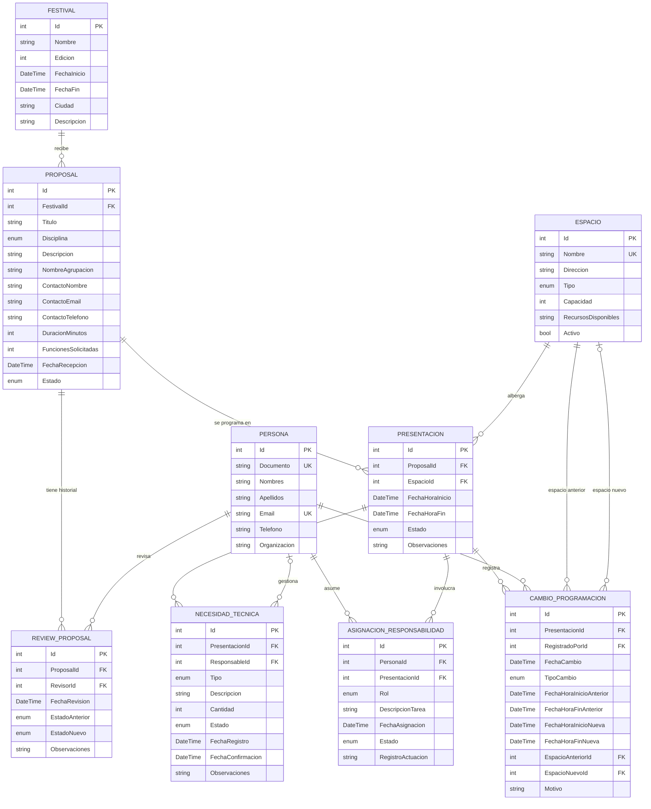

# 🎭 FestivalTask – Sistema de gestión de producción y programación de un festival de artes escénicas

API REST desarrollada en **ASP.NET Core Web API (.NET 10)** con **Entity Framework Core** y **SQL Server** para gestionar el ciclo completo de un festival de artes escénicas: desde la recepción y revisión de propuestas hasta la programación de presentaciones, la coordinación de necesidades técnicas, la asignación de responsabilidades y el registro de cambios.

> **Programación de Software – Práctica 2 – Tema 2**
> Instituto Tecnológico Metropolitano (ITM) · Docente: Orlando Alarcón Pérez

---

## 📑 Tabla de contenido

1. [Equipo de trabajo](#-equipo-de-trabajo)
2. [Problemática](#-problemática)
3. [Tecnologías utilizadas](#-tecnologías-utilizadas)
4. [Estructura de la solución](#-estructura-de-la-solución)
5. [Modelo de dominio](#-modelo-de-dominio)
6. [Diagrama entidad-relación](#-diagrama-entidad-relación)
7. [Reglas de negocio](#-reglas-de-negocio)
8. [Endpoints de la API](#-endpoints-de-la-api)
9. [SeedDb](#-seeddb)
10. [Instalación y ejecución](#-instalación-y-ejecución)
11. [Pruebas con Swagger y Postman](#-pruebas-con-swagger-y-postman)
12. [Flujo de trabajo en GitHub](#-flujo-de-trabajo-en-github)

---

## 👥 Equipo de trabajo

| Nombre | Usuario GitHub | Rama |
|---|---|---|
| Michael Estid Muñoz Alzate | [@michaelMunozA](https://github.com/michaelMunozA) | `michael-munoz` |
| Rogger Stiven Suaza Gutierrez | [@StivenGutierrezProgramming](https://github.com/StivenGutierrezProgramming) | `rogger-gutierrez` |
| Steven Cifuentes Ortiz | [@stevenCO123](https://github.com/stevenCO123) | `steven-cifuentes` |
| Jenny Andrea Ruiz Atehortu | [@JennyAndrea16](https://github.com/JennyAndrea16) | `jenny-ruiz` |
| Esteban Zapata Jimenez | [@Estebitan0](https://github.com/Estebitan0) | `esteban-zapata` |

---

## 📌 Problemática

Una organización cultural realiza periódicamente un festival con propuestas de teatro, danza, música y otras expresiones escénicas en diferentes espacios de la ciudad. La información de propuestas, horarios, espacios y necesidades de producción se manejaba en archivos y comunicaciones separadas, lo que dificultaba coordinar la programación.

Esta API centraliza esa información y permite:

- Registrar propuestas y conservar el historial de **revisiones y decisiones** (trazabilidad).
- Programar **presentaciones** asignando fecha, horario y espacio, evitando cruces.
- Controlar las **necesidades técnicas** (iluminación, sonido, escenografía, instrumentos) y su estado.
- Registrar las **responsabilidades** de cada persona y las actuaciones realizadas.
- Guardar cada **cambio de programación** con su motivo.
- Consultar la programación vigente, la disponibilidad de espacios y el historial del festival.

---

## 🛠 Tecnologías utilizadas

| Tecnología | Uso |
|---|---|
| .NET 10 | Plataforma de desarrollo |
| ASP.NET Core Web API | Construcción de la API REST |
| Entity Framework Core | ORM, relaciones, migraciones y persistencia |
| SQL Server | Base de datos relacional |
| Swagger (OpenAPI) | Documentación y prueba de endpoints |
| Postman | Colección de pruebas y población de tablas mediante POST |
| Visual Studio Professional 2026 | Entorno de desarrollo |
| Git y GitHub | Control de versiones y trabajo colaborativo |

---

## 📂 Estructura de la solución

La solución **`Festival`** está compuesta por dos proyectos:

| Proyecto | Tipo | Responsabilidad |
|---|---|---|
| `FestivalTask.Shared` | Biblioteca de clases | Entidades del dominio, enumeraciones y validaciones (Data Annotations) |
| `FestivalTask.API` | ASP.NET Core Web API | DbContext, migraciones, SeedDb, controladores CRUD y configuración |

```text
Festival.sln
│
├── FestivalTask.API
│   ├── Controllers
│   │   ├── AsignacionesResponsabilidadController.cs
│   │   ├── CambiosProgramacionController.cs
│   │   ├── EspaciosController.cs
│   │   ├── FestivalsController.cs
│   │   ├── NecesidadesTecnicasControllers.cs
│   │   ├── PersonasController.cs
│   │   ├── PresentacionesController.cs
│   │   ├── ProposalsController.cs
│   │   └── ReviewProposalsController.cs
│   ├── Data
│   │   ├── DataContext.cs
│   │   └── SeedDB.cs
│   ├── Migrations
│   ├── appsettings.json
│   ├── Festival.API.http
│   └── Program.cs
│
└── FestivalTask.Shared
    ├── Entities
    │   ├── AsignacionResponsabilidad.cs
    │   ├── CambioProgramacion.cs
    │   ├── Espacio.cs
    │   ├── Festival.cs
    │   ├── NecesidadTecnica.cs
    │   ├── Persona.cs
    │   ├── Presentacion.cs
    │   ├── Proposal.cs
    │   └── ReviewProposal.cs
    └── Enums
```

---

## 🧩 Modelo de dominio

El modelo está compuesto por **9 entidades**:

| Entidad | Descripción |
|---|---|
| **Festival** | Cada edición del festival que la organización realiza periódicamente. |
| **Proposal** | Propuesta artística recibida (teatro, danza, música, etc.) con su estado de revisión. |
| **ReviewProposal** | Historial de revisiones y decisiones tomadas sobre una propuesta. |
| **Espacio** | Lugares de la ciudad donde se realizan las presentaciones. |
| **Presentacion** | Función programada de una propuesta en un espacio, fecha y horario. |
| **NecesidadTecnica** | Requerimientos técnicos y logísticos de una presentación y su estado. |
| **Persona** | Integrantes de la coordinación, producción y ejecución del festival. |
| **AsignacionResponsabilidad** | Responsabilidad de una persona en una presentación (resuelve la relación N:M). |
| **CambioProgramacion** | Registro de cada modificación de una presentación y su motivo. |

### Relaciones principales

| Relación | Cardinalidad |
|---|---|
| Festival → Proposal | 1 : N |
| Proposal → ReviewProposal | 1 : N |
| Persona → ReviewProposal | 1 : N |
| Proposal → Presentacion | 1 : N |
| Espacio → Presentacion | 1 : N |
| Presentacion → NecesidadTecnica | 1 : N |
| Persona → NecesidadTecnica | 1 : N (opcional) |
| Persona ↔ Presentacion | N : M (mediante AsignacionResponsabilidad) |
| Presentacion → CambioProgramacion | 1 : N |
| Persona → CambioProgramacion | 1 : N |
| Espacio → CambioProgramacion | 1 : N (espacio anterior y espacio nuevo) |

### Enumeraciones

| Enum | Valores |
|---|---|
| Disciplina | Teatro, Danza, Musica, Circo, Otra |
| EstadoPropuesta | Recibida, EnRevision, RequiereAjustes, Aceptada, Descartada |
| TipoEspacio | SalaTeatro, Auditorio, AireLibre, EspacioAlternativo |
| EstadoPresentacion | Programada, Confirmada, Reprogramada, Realizada, Cancelada |
| TipoNecesidad | Iluminacion, Sonido, Escenografia, Instrumentos, Logistica, Otro |
| EstadoNecesidad | Pendiente, Confirmada, Modificada, Cancelada |
| RolResponsabilidad | Coordinador, Productor, TecnicoLuces, TecnicoSonido, Artista, Logistica |
| EstadoAsignacion | Asignada, EnCurso, Cumplida, NoCumplida |
| TipoCambio | CambioHorario, CambioEspacio, Cancelacion, Otro |

### Ejemplo de entidad

```csharp
public class Presentacion
{
    public int Id { get; set; }

    [Required]
    public int ProposalId { get; set; }
    public Proposal? Proposal { get; set; }

    [Required]
    public int EspacioId { get; set; }
    public Espacio? Espacio { get; set; }

    [Required(ErrorMessage = "La fecha y hora de inicio es obligatoria.")]
    public DateTime FechaHoraInicio { get; set; }

    [Required(ErrorMessage = "La fecha y hora de fin es obligatoria.")]
    public DateTime FechaHoraFin { get; set; }

    public EstadoPresentacion Estado { get; set; } = EstadoPresentacion.Programada;

    [MaxLength(500)]
    public string? Observaciones { get; set; }

    public ICollection<NecesidadTecnica>? NecesidadesTecnicas { get; set; }
    public ICollection<AsignacionResponsabilidad>? Asignaciones { get; set; }
    public ICollection<CambioProgramacion>? Cambios { get; set; }
}
```

---

## 🗺 Diagrama entidad-relación



---

## ⚖ Reglas de negocio

1. Solo se pueden programar presentaciones de propuestas con estado **Aceptada**.
2. No puede haber dos presentaciones activas en el mismo espacio con horarios que se crucen.
3. Las presentaciones deben estar dentro del rango de fechas del festival.
4. No se puede programar una presentación en un espacio inactivo.
5. Cada cambio de estado de una propuesta genera un registro en **ReviewProposal**.
6. Cada modificación de horario o espacio genera un registro en **CambioProgramacion**.
7. Una necesidad técnica **Confirmada** debe tener fecha de confirmación.
8. Las relaciones usan `DeleteBehavior.Restrict` para no perder la trazabilidad.

```csharp
// DataContext.cs – ejemplo de configuración de relaciones e índices
protected override void OnModelCreating(ModelBuilder modelBuilder)
{
    base.OnModelCreating(modelBuilder);

    modelBuilder.Entity<Espacio>().HasIndex(e => e.Nombre).IsUnique();
    modelBuilder.Entity<Persona>().HasIndex(p => p.Documento).IsUnique();
    modelBuilder.Entity<Persona>().HasIndex(p => p.Email).IsUnique();

    modelBuilder.Entity<CambioProgramacion>()
        .HasOne(c => c.EspacioAnterior)
        .WithMany()
        .HasForeignKey(c => c.EspacioAnteriorId)
        .OnDelete(DeleteBehavior.Restrict);

    modelBuilder.Entity<CambioProgramacion>()
        .HasOne(c => c.EspacioNuevo)
        .WithMany()
        .HasForeignKey(c => c.EspacioNuevoId)
        .OnDelete(DeleteBehavior.Restrict);

    foreach (var fk in modelBuilder.Model.GetEntityTypes().SelectMany(t => t.GetForeignKeys()))
    {
        fk.DeleteBehavior = DeleteBehavior.Restrict;
    }
}
```

---

## 🔌 Endpoints de la API

Todos los controladores implementan el CRUD completo:

| Método | Ruta | Descripción | Respuestas |
|---|---|---|---|
| `GET` | `/api/{recurso}` | Consultar todos los registros | `200 OK` |
| `GET` | `/api/{recurso}/{id}` | Consultar un registro por Id | `200 OK` · `404 Not Found` |
| `POST` | `/api/{recurso}` | Crear un registro | `201 Created` · `400 Bad Request` |
| `PUT` | `/api/{recurso}/{id}` | Actualizar un registro | `200 OK` / `204 No Content` · `400` · `404` |
| `DELETE` | `/api/{recurso}/{id}` | Eliminar un registro | `204 No Content` · `404 Not Found` |

### Recursos disponibles

| Controlador | Ruta base |
|---|---|
| FestivalsController | `/api/Festivals` |
| ProposalsController | `/api/Proposals` |
| ReviewProposalsController | `/api/ReviewProposals` |
| EspaciosController | `/api/Espacios` |
| PresentacionesController | `/api/Presentaciones` |
| NecesidadesTecnicasControllers | `/api/NecesidadesTecnicas` |
| PersonasController | `/api/Personas` |
| AsignacionesResponsabilidadController | `/api/AsignacionesResponsabilidad` |
| CambiosProgramacionController | `/api/CambiosProgramacion` |

### Ejemplo de controlador

```csharp
[ApiController]
[Route("api/[controller]")]
public class EspaciosController : ControllerBase
{
    private readonly DataContext _context;

    public EspaciosController(DataContext context)
    {
        _context = context;
    }

    [HttpGet]
    public async Task<IActionResult> GetAsync()
        => Ok(await _context.Espacios.ToListAsync());

    [HttpGet("{id:int}")]
    public async Task<IActionResult> GetAsync(int id)
    {
        var espacio = await _context.Espacios.FindAsync(id);
        return espacio is null ? NotFound() : Ok(espacio);
    }

    [HttpPost]
    public async Task<IActionResult> PostAsync(Espacio espacio)
    {
        _context.Espacios.Add(espacio);
        await _context.SaveChangesAsync();
        return CreatedAtAction(nameof(GetAsync), new { id = espacio.Id }, espacio);
    }

    [HttpPut("{id:int}")]
    public async Task<IActionResult> PutAsync(int id, Espacio espacio)
    {
        if (id != espacio.Id) return BadRequest("El Id no coincide.");
        if (!await _context.Espacios.AnyAsync(e => e.Id == id)) return NotFound();

        _context.Update(espacio);
        await _context.SaveChangesAsync();
        return Ok(espacio);
    }

    [HttpDelete("{id:int}")]
    public async Task<IActionResult> DeleteAsync(int id)
    {
        var espacio = await _context.Espacios.FindAsync(id);
        if (espacio is null) return NotFound();

        _context.Remove(espacio);
        await _context.SaveChangesAsync();
        return NoContent();
    }
}
```

### Ejemplo de solicitud POST

`POST /api/Proposals`

```json
{
  "festivalId": 1,
  "titulo": "Ecos de la montaña",
  "disciplina": 1,
  "descripcion": "Obra de danza contemporánea inspirada en la tradición antioqueña.",
  "nombreAgrupacion": "Colectivo Raíces",
  "contactoNombre": "Laura Gómez",
  "contactoEmail": "laura.gomez@raices.com",
  "contactoTelefono": "3001234567",
  "duracionMinutos": 60,
  "funcionesSolicitadas": 2,
  "fechaRecepcion": "2026-09-28T10:00:00",
  "estado": 0
}
```

---

## 🌱 SeedDb

Al iniciar la aplicación, la clase `SeedDB` aplica las migraciones pendientes y puebla automáticamente las tablas base (catálogos sin dependencias): **Festival**, **Espacio** y **Persona**. Antes de insertar se verifica si ya existen registros para evitar duplicados.

```csharp
public class SeedDB
{
    private readonly DataContext _context;

    public SeedDB(DataContext context)
    {
        _context = context;
    }

    public async Task SeedAsync()
    {
        await _context.Database.EnsureCreatedAsync();
        await CheckEspaciosAsync();
        await CheckPersonasAsync();
    }

    private async Task CheckEspaciosAsync()
    {
        if (!_context.Espacios.Any())
        {
            _context.Espacios.AddRange(
                new Espacio { Nombre = "Teatro Pablo Tobón Uribe", Direccion = "Cra. 40 #51-24, Medellín", Tipo = TipoEspacio.SalaTeatro, Capacidad = 850, Activo = true },
                new Espacio { Nombre = "Parque de los Deseos", Direccion = "Cl. 71 #52-30, Medellín", Tipo = TipoEspacio.AireLibre, Capacidad = 1500, Activo = true }
            );
            await _context.SaveChangesAsync();
        }
    }

    private async Task CheckPersonasAsync()
    {
        if (!_context.Personas.Any())
        {
            _context.Personas.AddRange(
                new Persona { Documento = "1000000001", Nombres = "Ana", Apellidos = "Restrepo", Email = "ana.restrepo@festival.com", Telefono = "3000000001" },
                new Persona { Documento = "1000000002", Nombres = "Carlos", Apellidos = "Mejía", Email = "carlos.mejia@festival.com", Telefono = "3000000002" }
            );
            await _context.SaveChangesAsync();
        }
    }
}
```

Registro en `Program.cs`:

```csharp
builder.Services.AddDbContext<DataContext>(x =>
    x.UseSqlServer(builder.Configuration.GetConnectionString("DefaultConnection")));
builder.Services.AddTransient<SeedDB>();

var app = builder.Build();

using (var scope = app.Services.CreateScope())
{
    var seeder = scope.ServiceProvider.GetRequiredService<SeedDB>();
    await seeder.SeedAsync();
}
```

---

## 🚀 Instalación y ejecución

### Requisitos previos

- Visual Studio 2026 con la carga de trabajo **ASP.NET y desarrollo web**
- SDK de **.NET 10**
- **SQL Server** (LocalDB, Express o Developer)

### Pasos

1. Clonar el repositorio:

   ```bash
   git clone https://github.com/<usuario>/<repositorio>.git
   ```

2. Configurar la cadena de conexión en `FestivalTask.API/appsettings.json`:

   ```json
   "ConnectionStrings": {
     "DefaultConnection": "Server=(localdb)\\MSSQLLocalDB;Database=FestivalDB;Trusted_Connection=True;MultipleActiveResultSets=true;TrustServerCertificate=True"
   }
   ```

3. Aplicar las migraciones desde la **Consola del Administrador de Paquetes** (proyecto predeterminado: `FestivalTask.API`):

   ```powershell
   Update-Database
   ```

   Para crear una nueva migración después de modificar el modelo:

   ```powershell
   Add-Migration NombreDeLaMigracion
   Update-Database
   ```

4. Ejecutar el proyecto `FestivalTask.API` (F5). Se abrirá Swagger automáticamente.

---

## 🧪 Pruebas con Swagger y Postman

### Swagger

Al ejecutar la API, la documentación queda disponible en:

```text
https://localhost:{puerto}/swagger
```

Desde allí se pueden visualizar y probar todos los endpoints.

### Postman

La colección de Postman incluye, para cada recurso:

| Prueba | Objetivo |
|---|---|
| `GET` todos | Verificar el listado de registros |
| `GET` por Id | Verificar consulta individual y respuesta `404` con Id inexistente |
| `POST` | Poblar las tablas a través de la API, incluyendo datos relacionados |
| `POST` inválido | Verificar respuesta `400` por validaciones |
| `PUT` | Verificar la actualización de registros |
| `DELETE` | Verificar la eliminación y la respuesta `404` en registros inexistentes |

**Orden recomendado para poblar las tablas con POST** (respetando las claves foráneas):

```text
Festival → Persona → Espacio → Proposal → ReviewProposal → Presentacion
        → NecesidadTecnica → AsignacionResponsabilidad → CambioProgramacion
```

---

## 🌿 Flujo de trabajo en GitHub

Cada integrante trabaja en su propia rama y luego integra sus cambios a `main` mediante Pull Request.

```bash
# Cambiarse a la rama personal
git checkout michael-munoz

# Guardar cambios
git add .
git commit -m "feat: CRUD de Espacios"
git push origin michael-munoz

# Actualizar la rama con los últimos cambios de main
git pull origin main
```

| Rama | Propósito |
|---|---|
| `main` | Versión estable e integrada del proyecto |
| `michael-munoz` | Desarrollo de Michael Estid Muñoz Alzate |
| `rogger-gutierrez` | Desarrollo de Rogger Stiven Suaza Gutierrez |
| `steven-cifuentes` | Desarrollo de Steven Cifuentes Ortiz |
| `jenny-ruiz` | Desarrollo de Jenny Andrea Ruiz Atehortu |
| `esteban-zapata` | Desarrollo de Esteban Zapata Jimenez |

---

<p align="center">Desarrollado por el equipo FestivalTask · ITM 2026</p>
